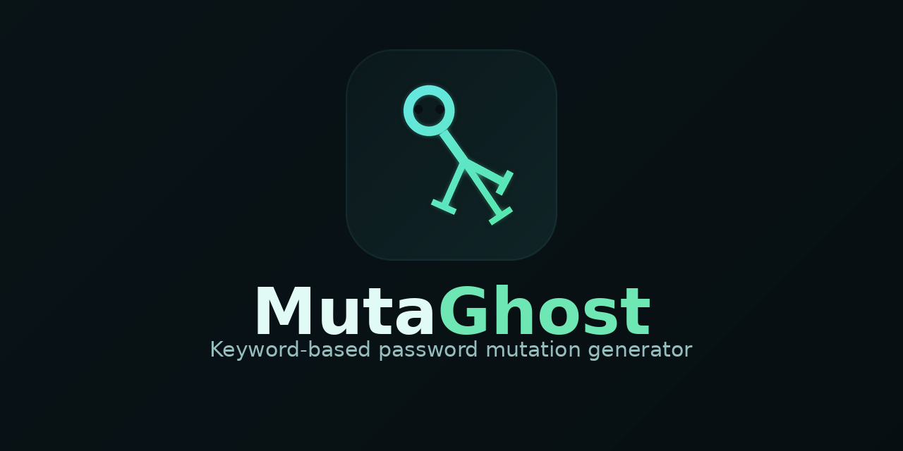
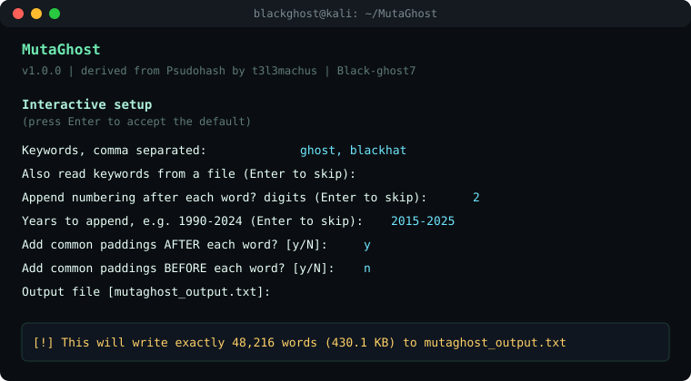
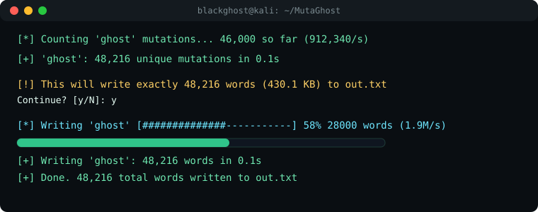

<p align="center">
  
</p>

# MutaGhost

Keyword-based password mutation generator. Derived from [Psudohash](https://github.com/t3l3machus/psudohash) by Panagiotis Chartas ([@t3l3machus](https://github.com/t3l3machus)), rewritten with a colored interactive menu, a real progress indicator, and an exact pre-run count. See [NOTICE.md](NOTICE.md) for the full attribution.

[](https://www.python.org/)
[](#supported-platforms)
[](LICENSE)

> For education and authorized security testing only. See [Responsible use](#responsible-use).

## What it does

Give MutaGhost one or more keywords (a name, a company, a pet) and it builds a wordlist of the realistic variants people actually use as passwords: leetspeak substitutions, upper/lower case mixes, numbering, years, and common paddings before or after the word. The output is meant to feed tools like Hashcat or John the Ripper for **authorized** password-strength testing.

```
ghost -> Ghost, GHOST, gh0st, Gh05t, ghost01, ghost_2024, !ghost, ghost!@#, ...
```

## Features

- 🖥️ **Interactive menu**, colored, in addition to command-line flags — just run `mutaghost`.
- 📊 **Live progress** while mutations are computed and while the file is written.
- 🔢 **Exact count and size before writing anything** — not an upper-bound guess. MutaGhost computes every unique mutation in memory first, so the number you confirm is the number you get.
- 🛡️ **Safety prompt** if a run grows past about 5 million words or 8 seconds of counting, so a runaway combination of options cannot silently fill your disk.
- 📂 **Keywords from a file** (`-wl/--wordlist`), in addition to `-w/--words`.
- 🔁 **True deduplication** — every stage (case, leet, numbering, years, padding) is deduplicated, so the file has no repeated lines.
- 🖼️ **Desktop icon and application-menu entry** on Linux, like other Kali tools.
- 📱 **Works on Termux** (Android), no root needed — the tool itself never needs root on any platform.

## Supported platforms

| Platform | Install | Notes |
|---|---|---|
| Kali / Debian / Ubuntu / Arch / Fedora / openSUSE | `./install.sh` (sudo) | Desktop icon and `mutaghost`/`mg` commands |
| Android (Termux) | `./install.sh` | `mutaghost`/`mg` commands, no root |

MutaGhost only reads keywords and writes a text file — it never touches the network, the firewall, or system settings, so it needs no root privileges anywhere. `install.sh` asks for `sudo` only to copy the files into a system-wide location on Linux.

## Screenshots

<p align="center"></p>
<p align="center"></p>

## Install

```bash
git clone https://github.com/Black-ghost7/MutaGhost.git
cd MutaGhost
chmod +x install.sh
./install.sh
```

The installer installs Python 3 if it is missing, copies the tool to `/usr/local/bin` (or `$PREFIX/bin` on Termux) as **`mutaghost`** and **`mg`**, and on Linux also installs the icon and application-menu entry (search for *MutaGhost* in your menu, or check your Desktop folder — right-click → **Allow Launching** if it shows a warning icon).

## Usage

Just type the name for the interactive menu:

```bash
mutaghost
```

Or use flags directly, which is handy for scripts:

```bash
mutaghost -w admin,company -cpa -o out.txt
mutaghost -wl employees.txt -an 2 -y 2015-2025 -cpa -o out.txt
mutaghost -w ghost -cpa -cpo -ap "!,@2024" -o out.txt   # only your own paddings
mutaghost -w test -o out.txt --yes                      # skip the confirmation
```

### Options

| Option | Description |
|---|---|
| `-w, --words LIST` | Comma-separated keywords |
| `-wl, --wordlist FILE` | Read keywords from a file (one per line, or comma-separated) |
| `-an, --append-numbering LEVEL` | Append numbering after each mutation (digits, e.g. `2` → `01`..`50`) |
| `-nl, --numbering-limit LIMIT` | Highest number for `-an` (default 50) |
| `-y, --years YEARS` | Single year, comma list, or range (`1990-2024`) |
| `-ap, --padding VALUES` | Comma-separated custom padding values |
| `-cpb, --paddings-before` | Add common paddings before each mutation |
| `-cpa, --paddings-after` | Add common paddings after each mutation |
| `-cpo, --custom-only` | Use only `--padding` values, not the built-in list |
| `-o, --output FILE` | Output file (default `mutaghost_output.txt`) |
| `--yes` | Skip the confirmation prompt |
| `--menu` | Force the interactive menu |
| `--no-color` | Disable colors |

Run `mutaghost --help` for the full list.

## How the exact count works

Psudohash's own pre-run estimate is an upper bound computed from a formula; the real output can be noticeably smaller once duplicates are removed, because case variants and leetspeak substitutions can collapse into the same string (for example, two case variants that differ only in the letter being substituted become identical after the substitution). MutaGhost avoids that gap: it generates every mutation into memory first, deduplicating as it goes, then shows you the **exact** number of words and bytes before asking to continue. Writing to disk is a second, separate pass over the already-computed list.

For very large jobs this uses more memory than writing straight to disk, which is why the safety prompt exists.

## Changelog

**v1.0.1**
- Fix: a word with many repeatable characters (e.g. the same letter many times) could make counting take far longer than the advertised safety threshold, up to appearing to hang. The root cause was an internal deduplication step that scaled quadratically; it is now linear, with no change to the output.
- New: colored block-letter banner in the terminal.

## Uninstall

```bash
./uninstall.sh
```

## Responsible use

MutaGhost is a password-auditing tool. Use it only to test passwords, accounts, or systems you own or are explicitly authorized to test. The author and the author of the original Psudohash project accept no liability for misuse.

## Attribution

This project is derived from [Psudohash](https://github.com/t3l3machus/psudohash) (MIT License) by Panagiotis Chartas. See [NOTICE.md](NOTICE.md) for what was kept and what changed, and [LICENSE](LICENSE) for the full license text.

## Connect

- GitHub: https://github.com/Black-ghost7
- LinkedIn: https://www.linkedin.com/in/black-ghost7
- TryHackMe: https://tryhackme.com/p/Blackghost7

## License

MIT — see [LICENSE](LICENSE). Covers both the original Psudohash code and MutaGhost's modifications.
